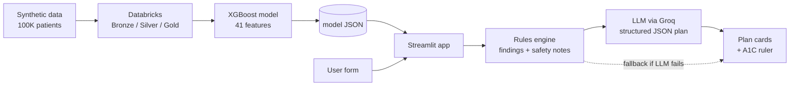

# NutriPath: A Food-as-Medicine Recommendation App for Type 2 Diabetes

[](https://nutri-path-diabetes-patient-recc-7dft5egcvolpzoks4wzwtb.streamlit.app/)

**Live demo:** https://nutri-path-diabetes-patient-recc-7dft5egcvolpzoks4wzwtb.streamlit.app/

NutriPath turns a person's health numbers (A1C, blood pressure, cholesterol, eating habits, medicines) into a **predicted 3-month A1C change** and a **plain-English action plan** they can actually read: 3 priorities for the week, a sample day of eating, a movement plan, sleep tips and questions to bring to their doctor.

I built it end to end as a Healthcare Data Analyst at [ChiEAC](https://www.chieac.org/), a Chicago nonprofit focused on upward mobility for underserved communities. The goal was a free, cloud-based, portfolio-quality project that shows the full path from raw data to a live public app.

> **Prototype.** NutriPath is trained on **synthetic data** and is for education only. It does not replace advice from a doctor or diabetes educator.

<!-- Add screenshots here after you take them from the live app:


-->

---

## What the app does

| Tab | What you get |
|---|---|
| **Population dashboard** | Filterable analytics over 100,000 example patient profiles: A1C distribution, predicted A1C drop by eating style, activity level and motivation, and predicted risk tiers. |
| **My personal plan** | A form with built-in help on where to find each number (lab report, pill bottle, visit summary). It returns an A1C ruler (now vs. in 3 months), a risk tier, and a structured plan laid out as cards. |

Every plan ends with a prompt to share it with a doctor or diabetes educator. Safety notes for insulin, GLP-1 medicines, kidney disease, neuropathy and retinopathy are always shown at the top.

---

## How it works



1. **Data (Databricks).** A synthetic diabetes dataset (100,000 patients, built with numpy/scipy so no real patient data is involved) flows through a Bronze, Silver and Gold medallion pipeline stored as Delta tables in Unity Catalog. Deduplication, type casting, and feature engineering happen in the pipeline.
2. **Model (XGBoost + MLflow).** An XGBoost regressor predicts the 3-month A1C reduction from 41 features (labs, vitals, lifestyle, medicines, comorbidities and engineered features such as carb-load ratio). It reaches an R² of about 0.91 on a held-out split of the synthetic data. The trained model is exported as a plain JSON file, so the deployed app does not depend on Databricks or MLflow.
3. **Layer 1: rules, no AI.** A rules engine checks the patient's numbers against common guideline targets (A1C 7%, blood pressure 130/80, LDL 100, triglycerides 150, and so on) and writes the findings. It also writes the medication and condition safety notes.
4. **Layer 2: LLM, plain English only.** The findings go to an LLM on Groq, which returns a **structured JSON plan** (priorities, meals, swaps, movement, sleep, doctor questions). The app validates the JSON and lays it out as cards.
5. **Graceful degradation.** If the main model fails, the app tries backup models. If all of them fail, it returns a rules-based plan in the same layout, so users are never left with an error.

---

## Design decisions worth calling out

- **Safety is code, not prompt.** Safety notes and the disclaimer are generated by rules and inserted by the app, so the LLM cannot skip or soften them.
- **The LLM writes; it does not decide.** Clinical thresholds live in transparent Python rules. The LLM only turns findings into readable language, with a prompt that enforces a 6th-grade reading level and short sentences.
- **Structured output over free text.** Asking for JSON and validating it let the plan become cards, not a wall of text. Bad or incomplete JSON triggers the next model or the fallback.
- **Portable deployment.** The model is exported to JSON and the dashboard data is a slim 8-column parquet, so the app runs on Streamlit Community Cloud's free tier.
- **Accessible design.** Atkinson Hyperlegible body text (designed for low-vision readers), a phone-friendly layout, a risk ramp that works for color-blind readers, and every colored mark labelled in words.
- **Privacy.** The app stores nothing. Form answers are sent to the LLM provider to write the plan, and the footer says so.

---

## Tech stack

**Data and ML:** Python, PySpark, pandas, numpy, scipy, Databricks (Delta Lake, Unity Catalog), MLflow, XGBoost
**App:** Streamlit, Plotly
**LLM:** Groq API (primary `qwen/qwen3.8-27b`, with `llama-3.3-70b-versatile` and `llama-3.1-8b-instant` as fallbacks)
**Deployment:** GitHub and Streamlit Community Cloud

---

## Repository structure

```
.
├── app.py                        # Streamlit app: form, rules engine, LLM plan, dashboard
├── requirements.txt              # Python dependencies
├── model/
│   └── nutripath_xgb.json        # Trained XGBoost model (exported from Databricks)
├── data/
│   └── dashboard_data.parquet    # Slim table powering the dashboard tab
└── .streamlit/
    └── config.toml               # Theme
```

---

## Run it locally

```bash
git clone https://github.com/SriramSrinivasan1/Nutri-Path-Diabetes-Patient-Recc.git
cd Nutri-Path-Diabetes-Patient-Recc
pip install -r requirements.txt
```

Create `.streamlit/secrets.toml` with your own Groq API key (do not commit this file):

```toml
GROQ_API_KEY = "your-key-here"
```

Then start the app:

```bash
streamlit run app.py
```

If no key is set, the app still runs and returns the rules-based plan.

---

## Limitations

- **Synthetic data.** The model learns patterns I generated, so its predictions show that the pipeline works, not real-world clinical outcomes. The dataset was only validated one variable at a time, not for realistic joint relationships between variables.
- **Concentrated signal.** A small number of features (for example GLP-1 use, A1C and diet adherence) carry most of the model's predictive weight. That mirrors how the synthetic outcome was generated and should not be read as clinical evidence.
- **Not medical advice.** Plans are general lifestyle guidance and are not a substitute for a clinician.
- **LLM variability.** The LLM can phrase plans differently each time. The rules layer, schema validation and fallbacks limit this but do not remove it.

---

## Roadmap

- Validate on real, de-identified data with a clinical or community partner
- Retrain a leaner model on the handful of fields that matter most and make the rest optional
- Add an "urgent care" banner for dangerous readings
- Add "what if" scenarios (for example, how the prediction changes if diet adherence improves)
- Spanish-language plans

---

## About

Built by **Sriram Srinivasan**, Data Science Fellow at ChiEAC.
[GitHub](https://github.com/SriramSrinivasan1) · [LinkedIn](https://www.linkedin.com/in/sriram-srinivasan00/)

## Disclaimer

NutriPath is a prototype built on synthetic data, for education only. It does not diagnose, treat or replace advice from a doctor or diabetes educator.
