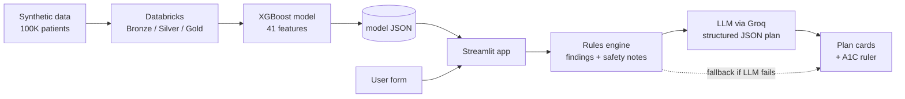

# 🥗 NutriPath — Food-as-Medicine Recommendations for Type 2 Diabetes
 
[](https://nutri-path-diabetes-patient-recc-7dft5egcvolpzoks4wzwtb.streamlit.app/)


 
> An end-to-end clinical AI app that turns a person's health numbers — A1C, blood pressure, cholesterol, eating habits and medicines — into a **predicted 3-month A1C change** and a **plain-English action plan** they can actually follow.
>
> **Built at [ChiEAC](https://www.chieac.org/) (Chicago Education Advocacy Cooperative) · Healthcare Data Analyst · 🔗 [Live Demo](https://nutri-path-diabetes-patient-recc-7dft5egcvolpzoks4wzwtb.streamlit.app/)**
  
<!-- Screenshots:


-->
 
---
 
## 🎯 Problem Statement
 
More than 38 million Americans live with diabetes, and diet is one of the most effective, lowest-cost tools for managing it. Yet most patients leave a diagnosis with a generic pamphlet — not a plan tied to their own numbers.
 
| Pain Point | How NutriPath Addresses It |
|---|---|
| **Generic advice:** Guidance isn't tied to the patient's labs, medicines or habits | Personalized plan built from 41 clinical, lifestyle and medication features |
| **No sense of progress:** Patients can't see how their choices affect A1C | Predicts the 3-month A1C change and shows it on a "now vs. 3 months" ruler |
| **Hard-to-read numbers:** Lab reports and visit summaries are confusing | Built-in help on where to find each number, and plans written at a 6th-grade reading level |
| **AI safety risk:** LLMs can invent or soften medical advice | Clinical logic and safety notes live in rules; the LLM only writes the explanation |
| **Privacy constraints:** Real patient data is HIPAA-protected | 100K synthetic patients; the app stores nothing |
 
---
 
## ⚙️ What It Does
 
| Tab | What You Get |
|---|---|
| 📊 **Population Dashboard** | Filterable analytics across **100,000 synthetic patients**: A1C distribution, predicted A1C drop by eating style, activity level and motivation, and predicted risk tiers |
| 📝 **My Personal Plan** | A guided form that returns an **A1C ruler**, a **risk tier** and a plan laid out as cards: 3 priorities for the week, a sample day of eating, a movement plan, sleep tips and questions for the doctor |
 
Safety notes for **insulin, GLP-1 medicines, kidney disease, neuropathy and retinopathy** always appear at the top, and every plan ends with a prompt to share it with a clinician.
 
---
 
## 🏗️ System Architecture
 

 
---
 
## 🔬 Pipeline Walkthrough
 
**1. Data engineering (Databricks).** A 100,000-patient synthetic diabetes dataset, generated with numpy and scipy so no real patient data is involved, flows through a **Bronze → Silver → Gold medallion pipeline** stored as Delta tables in Unity Catalog. Deduplication, type casting and feature engineering happen inside the pipeline.
 
**2. Predictive model (XGBoost + MLflow).** An XGBoost regressor predicts the 3-month A1C reduction from **41 features**: labs, vitals, lifestyle, medicines, comorbidities and engineered features such as carb-load ratio. It reaches **R² ≈ 0.91** on a held-out split of the synthetic data. The model is exported as plain JSON, so the live app doesn't depend on Databricks or MLflow.
 
**3. Layer 1 — Rules engine (no AI).** Transparent Python rules check the patient's numbers against guideline targets (A1C 7%, blood pressure 130/80, LDL 100, triglycerides 150) and write the clinical findings and medication and condition safety notes.
 
**4. Layer 2 — LLM explainer (plain English only).** The findings go to an LLM on Groq, which returns a **structured JSON plan**. The app validates the JSON and renders it as cards.
 
**5. Graceful degradation.** If the primary LLM fails, the app tries backup models. If all of them fail, it returns a rules-based plan in the same layout — users never see an error.
 
---
 
## ⚖️ Design Decisions & Trade-offs
 
| Decision | Rationale | Trade-off |
|---|---|---|
| **Safety is code, not prompt** | Safety notes and the disclaimer come from rules and are inserted by the app, so the LLM can't skip or soften them | Safety coverage is limited to the conditions the rules explicitly check |
| **The LLM writes; it doesn't decide** | Clinical thresholds live in transparent Python rules; the LLM only turns findings into readable language | Plans are less open-ended than a free-form chatbot |
| **Structured JSON over free text** | Validated JSON becomes scannable cards, not a wall of text; bad output triggers the next model or the fallback | Stricter schema means more retries when the LLM drifts |
| **Model exported to JSON** | The app runs on Streamlit Community Cloud's free tier with no Databricks or MLflow dependency | Retraining requires a manual re-export |
| **Slim 8-column parquet for the dashboard** | Keeps the deployed app fast and lightweight | Dashboard filters are limited to the exported fields |
| **Accessible design** | Atkinson Hyperlegible font for low-vision readers, phone-friendly layout, a color-blind-safe risk ramp and every colored mark labeled in words | Fewer visual styling options |
| **Stateless privacy** | The app stores nothing; form answers go only to the LLM provider to write the plan | No saved history or progress tracking for returning users |
 
---
 
## 🧰 Tech Stack
 
| Category | Tools |
|---|---|
| **Data engineering** | Databricks, PySpark, Delta Lake, Unity Catalog |
| **Data generation & wrangling** | Python, pandas, NumPy, SciPy |
| **Machine learning** | XGBoost, MLflow |
| **LLM layer** | Groq API — `qwen/qwen3.8-27b` (primary), `llama-3.3-70b-versatile` and `llama-3.1-8b-instant` (fallbacks) |
| **App & visualization** | Streamlit, Plotly |
| **Deployment** | GitHub, Streamlit Community Cloud |
 
---
 
## 🚀 Getting Started
 
### Run Locally
```bash
git clone https://github.com/SriramSrinivasan1/Nutri-Path-Diabetes-Patient-Recc.git
cd Nutri-Path-Diabetes-Patient-Recc
pip install -r requirements.txt
```
 
Add your Groq API key to `.streamlit/secrets.toml` (never commit this file):
```toml
GROQ_API_KEY = "your-key-here"
```
 
Start the app:
```bash
streamlit run app.py
```
 
> **No key?** The app still runs and returns the rules-based plan.
 
---
 
## ⚠️ Limitations & Future Work
 
### Limitations
1. **Synthetic data** — predictions show the pipeline works, not real-world clinical outcomes. The dataset was validated one variable at a time, not for realistic relationships between variables.
2. **Concentrated signal** — a few features (GLP-1 use, A1C and diet adherence) carry most of the predictive weight. That mirrors how the synthetic outcome was generated and isn't clinical evidence.
3. **LLM variability** — wording can change between runs. Rules, schema validation and fallbacks limit this but don't remove it.
4. **Not medical advice** — plans are general lifestyle guidance, not a substitute for a clinician.
### Roadmap
 
| Horizon | Enhancement |
|---|---|
| **Short term** | Add an urgent-care banner for dangerous readings |
| **Medium term** | Retrain a leaner model on the few fields that matter most and make the rest optional · Add "what if" scenarios (e.g. improved diet adherence) · Spanish-language plans |
| **Long term** | Validate on real, de-identified data with a clinical or community partner |
 
---
 
## 💡 Project Impact
 
NutriPath shows the full path from raw data to a live, public clinical AI app — **data engineering, predictive modeling, guardrailed LLM output and accessible design** — all on free-tier infrastructure. Its core design principle carries over to any healthcare AI product: **keep clinical decisions in transparent, auditable rules, and use the LLM only to communicate them.**
 
**Skills demonstrated:**
- Medallion data pipelines on Databricks (Delta Lake, Unity Catalog)
- Regression modeling and experiment tracking (XGBoost, MLflow)
- Guardrailed LLM integration with structured output, validation and multi-model fallback
- Clinical guideline translation into rules-based decision logic
- Accessible, patient-facing product design
---
 
## 📁 Repository Structure
 
```
.
├── app.py                        # Streamlit app: form, rules engine, LLM plan, dashboard
├── requirements.txt              # Python dependencies
├── model/
│   └── nutripath_xgb.json        # Trained XGBoost model (exported from Databricks)
├── data/
│   └── dashboard_data.parquet    # Slim table powering the dashboard tab
└── .streamlit/
    └── config.toml               # Theme
```
 
---

*NutriPath is a prototype built on synthetic data, for education purposes only. It does not diagnose, treat or replace advice from a healthcare professional.*
